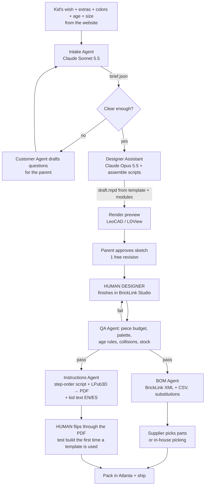

# BrickWish: AI Design Pipeline

How a kid's wish becomes a buildable model, a printed manual and a parts list, quickly enough to make money (see BUSINESS_PLAN.md §4: design time is the main cost).

Research as of 12 October 2026. Tags: **[V]** = checked in source code or a README; **[U]** = from search extracts only. Verify before relying on it.

## Status: built (12 Oct 2026)

The fully automatic version of this pipeline is now in the repo. It is the one the business runs on (AUTOMATION.md):

- **`engine/`:** a deterministic brick engine. It turns a design spec into bricks, a connection check, age-based steps, numbered bags, the manual PDF, the 5-page preview, the 9:16 build video and the vendor parts files.
- **`agents/design_agent.py`:** the Design Agent (Claude Opus 5.5). It writes the spec, calls `build_preview` to compile it and **look at front/back renders**, fixes problems, and calls `submit_design` once the model passes. Brands become generic versions automatically.
- **`agents/worker.py` + `agents/api.py`:** run the whole order lifecycle 24/7.

So the human designer described below is **no longer in the loop per order**. A person only sees orders that fail (`needs_help`). The research below still guides the next engine upgrades: plates, slopes, Technic, and a library of proven shapes the agent can reuse.

## The rule

> **AI agents choose and fill in parameters. Scripts build and check. A human designer owns the final shape.**

As of October 2026, no tool can turn "Dalmatian, 300 pieces, age 7–9" into a kid-ready model that uses plates and slopes and has a face you'd recognize. The best 2026 research (BrickBench, Oct 2026 [U]) reaches the same conclusion: agents with building and checking tools "build what works, not yet what makes a great design." So AI saves time around the designer instead of replacing them.

## 1. What exists today

| Tool | What it does | Can we use it commercially? |
|---|---|---|
| **BrickGPT** (formerly LegoGPT, Carnegie Mellon, ICCV 2025 Best Paper), [repo](https://github.com/AvaLovelace1/BrickGPT) | Text → stable brick-by-brick model. Only 8 basic brick types, 20×20×20 grid, no plates or slopes [V] | Code MIT [V], but it is built on Llama 3.2 (Llama licence applies [U]), and the physics check needs Gurobi, whose academic licence is non-commercial [V]. **Good for experiments, not production.** |
| BrickGPT `mesh2brick` | Any 3D mesh → bricks [V] | MIT [V] |
| BrickNet (CVPR 2026) | Models over arbitrary LDraw parts | Research use only [U] |
| TRELLIS.2 / TripoSR / Hunyuan3D | Image or text → 3D mesh | TripoSR MIT [V]. TRELLIS relies on NVIDIA nvdiffrast, which is research-only [V]. Hunyuan excludes the EU, UK and South Korea [V] |
| **BrickForgerAI** (Sep 2026), [repo](https://github.com/Doshi143/BrickForgerAI) | Prompt → image → 3D → studs/plates → `.ldr` + parts list + PDF. "Detailed" mode: Claude writes a spec, and a deterministic engine builds it [V] | Source-available, all rights reserved. **Use it as a reference design, not a dependency.** |
| **BrickLink Studio** | Free 3D brick editor with an instruction maker and stability check | Free. **Our designers' editor.** No scripting API found [U] |
| **LDraw** format (`.ldr`, `.mpd`) | Plain-text model files with `0 STEP` markers. Parts library is CC BY 4.0 [U] | Yes. **Our master file format.** |
| **LPub3D**, [repo](https://github.com/trevorsandy/lpub3d) | Lays out instruction pages and runs headless: `lpub3d -pe -o pdf -of kit.pdf kit.mpd`. Also exports `bl-xml` and `csv` parts lists [V] | GPLv3; fine to use as a tool. **It does not decide build order**, so we write that script ourselves. |
| LeoCAD / LDView | Command-line renders of each step [V] | GPLv2 |

## 2. The pipeline



The **Customer Update Agent** sends status emails to the parent at each stage: received, sketch ready, approved, shipped.

## 3. Agent roles

| Agent | Input | Output | Tools | Human checkpoint |
|---|---|---|---|---|
| **Intake** (`claude-sonnet-5-5`) | Wish, extras, colors, age, size | `brief.json` (schema below) | Template catalog, palette list, structured output | A human looks only if `risk_flags` is not empty |
| **Concept / Preview** | Brief + draft model | 2 renders + "what you'll get" text for the parent | LeoCAD/LDView renders of the real draft | Parent approval |
| **Designer Assistant** (`claude-opus-5-5`) | Approved brief | `draft.mpd` + `params.json` | Template and module library, recolor/assemble scripts, LDraw validator | **Designer edits: this is where the human time goes** |
| **QA** | `model.mpd` | Pass/fail report | LDraw parser, piece count, palette check, age-rule checker, collision check, Studio stability check (manual) | Designer fixes failures |
| **BOM / Parts** | Final `.mpd` | BrickLink XML, Rebrickable CSV, cost, substitutions | LPub3D export, our color/part ID map, supplier upload | Approve substitutions |
| **Instructions** | Final `.mpd` + age rules | Stepped `.mpd` → PDF, cover with "Built by [name]", tips in EN/ES | Step-ordering script, LPub3D CLI, Claude for the text | Flip through the PDF |
| **Customer Update** (`claude-sonnet-5-5`) | Order events | Emails to the parent | Email/CRM | Complaints and refunds stay human |

**Where AI helps today:** writing the brief, asking clarifying questions, choosing the template and modules, mapping colors to the palette, converting parts lists, handling substitutions, splitting steps, running LPub3D, writing kid-friendly text in English and Spanish, rule-based QA, and status emails.

**Where a human is still needed:** likeness (faces, animal character, pose), stability with plates/slopes/SNOT, sub-assembly design, the final PDF check, and physical test builds.

## 4. Template library: the real speed lever

- **Start with the 12 picture buttons on the site:** dog, cat, dinosaur (+ dragon wings module), horse (+ unicorn horn module), fish/shark, rocket, car (+ race-car module), train, castle, robot, house. Later add bird, plane, boat and humanoid.
- **Each family is a parameterized `.mpd`** with:
  - sub-models with named attach points (head, ears, tail, cockpit, roof…)
  - **color slots** (primary / secondary / accent / eyes) restricted to the 12-color palette
  - one size variant per tier (Mini → Mega)
  - steps already sequenced for each age band
  - a parts list that has been physically test-built
- **Extras are modules:** crown, sunglasses, wings, rainbow, flames, treasure, flowers, tiny friend (the "extras" step on the site).
- **Example:** "Dalmatian puppy with a red collar" = dog family, primary white, black spot tiles, red accent collar module. "Rocket with a cat pilot" = rocket family + cockpit + cat-head module.
- **Recoloring and module swaps are a plain script.** The LLM only outputs parameters.
- **Every order the library can't cover becomes a new module.** The library is a business asset that grows with each order.

**Design minutes per order** (estimates; measure real ones from order #1):

| Tier | From scratch | Template fits | New module needed |
|---|---|---|---|
| Mini 80–150 | 90–150 | **15–30** | 45–90 |
| Medium 200–350 | 180–360 | **30–60** | 90–180 |
| Big 400–650 | 360–720 | **60–150** | 180–360 |
| Mega 800–1,200 | 600–1,200+ | **150–300** | 360–600 |

## 5. Difficulty rules by age

Rules of thumb, based on LEGO 4+ practice and Agrawala et al. 2003 ([paper](https://graphics.stanford.edu/papers/assembly_instructions/)). The QA and Instructions agents enforce them.

| Rule | 4–6 | 7–9 | 10–12 | 13+ |
|---|---|---|---|---|
| New parts per step | 1–3 | 2–5 | 3–8 | 4–12 |
| Steps for a 150-piece model | 60–75 | 35–50 | 25–35 | 15–25 |
| Sub-assemblies | None (or 1 on a "build first" page) | ≤1 level, 2–4 per model | ≤2 levels, mirrored pairs OK | Nested, "×N" callouts |
| Technic pins/axles | None | A few friction pins shown 1:1 | Yes, with 1:1 length callouts | Full Technic, hinges |
| Parts and techniques | Big bricks and plates, few 1×1s, no clips or hinges, start on a base plate | Slopes, tiles, simple SNOT bracket | SNOT, clips, hinges | Anything in the palette |
| Color callouts | Color name + swatch for every part; never put look-alike colors in the same step | Swatch for each new color | Standard callout | Standard |
| Page layout | 1 step per page, new parts highlighted, an arrow for every placement, few rotations | 1–2 steps per page | 2–4 per page | 3–6 per page |
| Text | Pictures only + a parent tip box | 1 short sentence per section | Short tips | Optional design notes |
| Parts per numbered bag | 20–40 | 40–80 | 80–150 | 150–250 |
| Sizes offered (site shows "Great for this age") | Mini, Medium | Medium, Big | Big, Mega | Big, Mega |

## 6. Intake Agent

**Model:** `claude-sonnet-5-5`. Enforce the schema with Claude's structured-output feature so the reply is always valid JSON. Send the template catalog, the palette and the age rules (§5) with every request.

**Privacy (COPPA):**
- The wish is sent only after a parent has checked out and consented.
- The site has already stripped emails, phone numbers and addresses.
- Use an AI vendor contract that bars training on, or reuse of, the text.
- Delete briefs 90 days after delivery.

### System prompt

```
You are the Intake Agent for BrickWish, a studio that designs custom brick-building kits for kids.
Turn ONE order (the child's wish, chosen extras, chosen colors, age range and size) into ONE design brief that matches the JSON schema.

- Copy the child's words exactly into kid_quote. Never drop anything they asked for.
- Add only the 2–4 features that make the subject recognizable (Dalmatian → white body, black spots, floppy black ears).
- Pick the closest template_family from the catalog provided, or "none" if nothing fits. List any extra modules in secondary_elements.
- Use only colors from the palette provided. If the child asked for a color we don't stock, choose the nearest palette color and explain in color_notes.
- If colors were "surprise", choose a cheerful palette that suits the subject.
- Keep piece_budget inside the size range: Mini 80–150, Medium 200–350, Big 400–650, Mega 800–1200.
- Fill difficulty from the age rules provided. Put age-related safety notes in safety_notes (e.g. small parts for 4–6).
- If the wish names a brand, a licensed character, a logo, a real person, a weapon, scary or violent content, or personal information, add a risk_flags entry and suggest a generic alternative (e.g. "a superhero spider" instead of Spider-Man).
- If the subject, colors, pose or scale is unclear, write up to 3 short, friendly parent_questions in the order language instead of guessing.
- Write all free text in the order language (en or es). Return JSON only.
```

### JSON schema

```json
{
  "type": "object",
  "additionalProperties": false,
  "required": ["subject", "kid_quote", "language", "template_family", "secondary_elements", "key_features", "colors",
               "color_notes", "pose", "scale", "piece_budget", "age_range", "difficulty", "safety_notes",
               "risk_flags", "parent_questions", "confidence"],
  "properties": {
    "subject": { "type": "string" },
    "kid_quote": { "type": "string" },
    "language": { "type": "string", "enum": ["en", "es"] },
    "template_family": { "type": "string", "enum": ["dog", "cat", "dinosaur", "horse", "fish", "bird", "rocket", "plane",
      "car", "train", "boat", "castle", "house", "robot", "humanoid", "none"] },
    "secondary_elements": { "type": "array", "items": { "type": "string" } },
    "key_features": { "type": "array", "items": { "type": "object", "additionalProperties": false,
      "required": ["feature", "priority"],
      "properties": { "feature": { "type": "string" }, "priority": { "type": "string", "enum": ["must", "nice"] } } } },
    "colors": { "type": "array", "items": { "type": "object", "additionalProperties": false,
      "required": ["slot", "palette_color"],
      "properties": {
        "slot": { "type": "string", "enum": ["primary", "secondary", "accent", "eyes", "base"] },
        "palette_color": { "type": "string", "enum": ["red", "orange", "yellow", "green", "blue", "purple", "pink",
          "brown", "tan", "gray", "white", "black"] } } } },
    "color_notes": { "type": "string" },
    "pose": { "type": "string" },
    "scale": { "type": "string", "enum": ["small_display", "playable", "large_display"] },
    "piece_budget": { "type": "object", "additionalProperties": false, "required": ["tier", "min", "target", "max"],
      "properties": { "tier": { "type": "string", "enum": ["mini", "medium", "big", "mega"] },
        "min": { "type": "integer" }, "target": { "type": "integer" }, "max": { "type": "integer" } } },
    "age_range": { "type": "string", "enum": ["4-6", "7-9", "10-12", "13+"] },
    "difficulty": { "type": "object", "additionalProperties": false,
      "required": ["max_new_parts_per_step", "max_subassembly_depth", "technic_allowed", "snot_allowed", "text_level"],
      "properties": { "max_new_parts_per_step": { "type": "integer" }, "max_subassembly_depth": { "type": "integer" },
        "technic_allowed": { "type": "boolean" }, "snot_allowed": { "type": "boolean" },
        "text_level": { "type": "string", "enum": ["pictures_only", "short_sentences", "standard"] } } },
    "safety_notes": { "type": "array", "items": { "type": "string" } },
    "risk_flags": { "type": "array", "items": { "type": "string" } },
    "parent_questions": { "type": "array", "items": { "type": "string" } },
    "confidence": { "type": "number" }
  }
}
```

The LLM outputs palette **names**, not supplier IDs. A lookup table (`palette.csv`: our name → LDraw / BrickLink / Rebrickable / Gobricks color IDs) does the mapping, because the same color has different IDs in each system. The Rebrickable API v3 provides the cross-references [U].

## 7. Build order (what to code first)

1. **Order inbox:** the website POSTs the order JSON (see `CONFIG.orderEndpoint` in `site/index.html`) to a small serverless function that stores it and calls the Intake Agent.
2. **Palette + ID map** (`palette.csv`) and the **template catalog** (`templates.json`).
3. **First 3 templates** in Studio → exported to `.mpd`.
4. **Recolor/assemble script** (template + params → draft `.mpd`).
5. **Step-ordering script** (by sub-model, then layer, capped by age) → **LPub3D** → PDF.
6. **BOM export** → supplier upload format.
7. Designer Assistant and QA Agent, once there are 10+ real orders to learn from.
