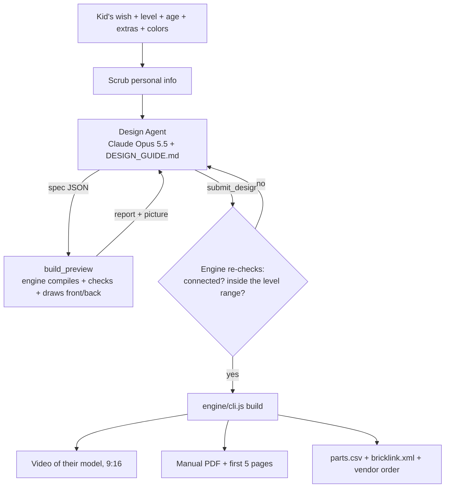

# BrickWish: AI Design Pipeline

How a kid's wish becomes a buildable model, the video of that model, a manual and a parts list, with no person in the loop.

Updated 12 October 2026. Research tags: **[V]** = checked in source code or a README; **[U]** = from search extracts only.

## The rules the agents follow

The Design Agent's instructions are [engine/DESIGN_GUIDE.md](engine/DESIGN_GUIDE.md). Two rules come first:

1. **Every wish gets built.** Never refuse. Huge things (a mountain, a city) become dioramas, tiny things become big sculptures, abstract wishes become scenes, places become dioramas with their landmarks, people and animals. Brands become generic versions and scary things become friendly versions, each with a one-line note to the parent.
2. **The level sets the size and the detail.** The family picks the level; the agent must land inside its piece range and spend the extra pieces on detail, not just size.

| Level | Pieces | What the model includes |
|---|---|---|
| 1 Starter | 100–250 | The silhouette and 2–4 signature colors |
| 2 Explorer | 300–600 | + main details (eyes, windows, stripes, doors) |
| 3 Builder | 700–1,200 | + textures, accessories, a simple scene (ground + 2–6 props) |
| 4 Master | 1,300–2,400 | + a full diorama: ground, water or street, people, animals, patterns |
| 5 Legend | 2,500–4,500 | + several sub-builds, fine textures, 8+ colors, surroundings on every side |
| 6 Epic | 5,000–8,000 | Display piece: detail everywhere plus surroundings |

## The pipeline

- **The agent sees its own work.** Every `build_preview` returns the piece count, the level range, warnings (floating pieces, weak joints, out of range) and a picture of the front and back. The agent fixes what it sees, up to 6 previews.
- **The order decides, not the model.** Level, age and the child's words are forced from the order onto every spec.
- **One engine everywhere.** `engine/engine.js` has no dependencies and runs in Node (the server) and in the browser (the website's live preview), so what the kid sees is what the vendor ships.
- **Refusals fall back automatically.** The API call uses server-side fallbacks, so a refusal is retried on the model Anthropic recommends for that category. If the design still can't be finished, the order goes to `needs_help` and the founders get an email.

## What the engine does with a spec

| Stage | What happens |
|---|---|
| Shapes → cells | Boxes, tapers, cylinders, cones, ellipsoids, lines, sagging cables, terrain with peaks and color bands, water, paint patterns, carving, and prefabs (trees, pines, palms, bushes, flowers, rocks, houses, hillside houses, towers, people, dogs, cars, buses, benches, lamps, boats, gondolas). `on_surface` drops things onto the ground below them. |
| Hollowing | Big volumes are hollowed to save pieces while keeping every slope's skin connected. |
| Cells → bricks | Greedy packing with 11 brick sizes, alternating directions so layers lock together; round bricks and cones as special elements. |
| Connection check + repair | Every brick must connect to the table through studs. Loose bricks are re-cut together with a neighbor or bridged from the layer above; anything left is reported to the agent. |
| Steps and bags | Bottom to top, back to front, in tiles, with parts per step and bag size by age. |
| Manual | Cover, tips, a parts list per bag, every step with the new pieces outlined in pink, a final page. Big scenes are embedded as compressed pictures so 5,000-piece manuals stay small. |
| Video | three.js renders the bricks dropping in step by step, then a spin, recorded frame by frame into a 9:16 MP4. |
| Vendor files | Parts by bag with BrickLink color IDs, BrickLink XML, packing and label instructions. |

## Age rules (from the engine)

| Rule | 4–6 | 7–9 | 10–12 | 13+ |
|---|---|---|---|---|
| New parts per step | up to 3 | up to 5 | up to 8 | up to 12 |
| Steps per page | 1 | 2 | 2 | 4 |
| Parts per numbered bag | about 30 | about 60 | about 120 | about 200 |
| Levels the site marks "Great for this age" | 1–2 | 2–3 | 3–4 | 4–6 |

Based on LEGO 4+ practice and Agrawala et al. 2003 ([paper](https://graphics.stanford.edu/papers/assembly_instructions/)).

## Next engine upgrades

1. **Plates and tiles** (one-third height): finer detail, smoother slopes, smooth roads.
2. **Slopes:** roofs, noses, mountain faces.
3. **A library of proven designs** the agent can reuse (the four examples are the first entries).
4. **Hinges, wheels, SNOT brackets** for the 10–12 and 13+ ages.

## Background research (what exists outside BrickWish)

| Tool | What it does | Commercial use |
|---|---|---|
| **BrickGPT** (formerly LegoGPT, Carnegie Mellon, ICCV 2025 Best Paper), [repo](https://github.com/AvaLovelace1/BrickGPT) | Text → stable brick-by-brick model. Only 8 basic brick types, 20×20×20 grid, no plates or slopes [V] | Code MIT [V], built on Llama 3.2 (Llama licence [U]); its physics check needs Gurobi, academic licence non-commercial [V] |
| BrickNet (CVPR 2026) | Models over arbitrary LDraw parts | Research use only [U] |
| TRELLIS.2 / TripoSR / Hunyuan3D | Image or text → 3D mesh | TripoSR MIT [V]; TRELLIS relies on research-only nvdiffrast [V]; Hunyuan excludes the EU, UK and South Korea [V] |
| **BrickForgerAI** (Sep 2026), [repo](https://github.com/Doshi143/BrickForgerAI) | Prompt → image → 3D → `.ldr` + parts list + PDF; "detailed" mode has Claude write a spec for a deterministic engine [V] | Source-available, all rights reserved; reference only |
| **LDraw** (`.ldr`, `.mpd`) + **LPub3D** | Open model format and an instruction-layout tool | Possible export target later, for customers who want to edit their model in BrickLink Studio |

Our approach is the "Claude writes a spec, a deterministic engine builds it" pattern, with the engine written for this business so it can check connections, follow the age rules, make the video and talk to the vendor.
