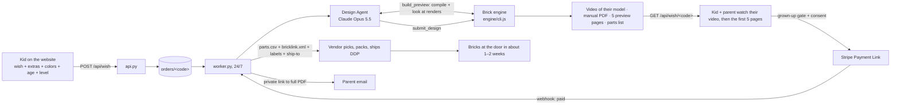

# BrickWish: The Automatic Business

**Goal:** a kid makes a wish, and everything after that happens without a person: design, manual, video, payment, parts order, delivery emails. The founders handle marketing and the rare order the machines can't finish.

**Status (12 Oct 2026):** the core is built and tested end to end in this repo, with four test wishes from Level 1 to Level 6 (231 to 5,111 pieces). What still needs your accounts (Anthropic API key, Stripe, email, a server, a signed vendor) is listed at the bottom.

## 1. The flow



**Timing per order** (engine measured on this container; design agent estimated, it has not run against the live API yet):

| Level | Design agent | Engine (manual + preview + video) |
|---|---|---|
| 1 (231 pieces) | 1–3 min | about 2 min |
| 3 (767 pieces) | 3–6 min | about 5 min |
| 4 (1,359 pieces) | 5–10 min | about 8 min |
| 6 (5,111 pieces) | 10–20 min | about 30 min |

**Cost per design:** about $0.80 of Claude usage at Level 1, up to about $3 at Level 6, plus pennies of compute (estimates; measure from the API dashboard).

## 2. Who does what

| Job | Done by | Automatic? | Code |
|---|---|---|---|
| Kid describes the wish, picks options | Website | ✅ | `site/index.html` |
| Strip personal info from the wish | Website + API | ✅ | `scrub()` in both |
| Turn the wish into a 3D brick design, check it, fix it | **Design Agent** (Claude Opus 5.5) | ✅ | `agents/design_agent.py` |
| Rules: every wish gets built; the level sets size and detail; brands → generic, scary → friendly | Design guide (the agent's instructions) | ✅, with a note to the parent | `engine/DESIGN_GUIDE.md` |
| Bricks, connection check and repair, steps by age, numbered bags | Brick engine | ✅ | `engine/engine.js` |
| Manual PDF + 5-page preview | Brick engine | ✅ | `engine/engine.js` + `engine/cli.js` |
| Video of the kid's own model (9:16, ready for Reels/TikTok/Shorts) | Brick engine | ✅ | `engine/viewer.js` + `engine/cli.js` |
| Payment, email, shipping address, builder's name | Stripe Payment Link | ✅ | Stripe dashboard (setup below) |
| Personalize the cover, order parts, email the parent | Worker | ✅ | `agents/worker.py` |
| Pick, pack, label, ship DDP | Vendor | ✅ for us (vendor's people do it) | `engine/engine.js` makes their files |
| Delete old data (privacy policy) | Worker, hourly | ✅ | `cleanup()` |
| Daily report to founders | Worker, 8:00 Atlanta | ✅ | `daily_report()` |
| Design fails or something breaks | Worker → email to founders | ⚠️ needs a person | `needs_help` state |
| Tracking numbers from vendor → parent | Next to build | ⏳ | an email-reading agent |
| Customer questions, missing pieces | Next to build | ⏳ | a support agent with refund limits |
| Marketing distribution | Your plan | ⏳ | hooks described in §6 |

## 3. The rule: every wish gets built

- **Nothing is refused.** It's rule 1 of the design guide the agent follows. Huge things (a mountain, a city) become dioramas, tiny things become big sculptures, abstract wishes become scenes, places become dioramas with their landmarks, people and animals.
- **The engine has the vocabulary for it:** terrain with peaks and color bands, water, roads and paths, buildings with window patterns, bridges with sagging cables and hangers, and ready-made props (trees, pines, palms, bushes, flowers, rocks, houses, hillside houses, towers, people, dogs, cars, buses, benches, lamps, boats, cable-car gondolas).
- **Proof in [examples/](examples/):** "Empire State Building" (Level 1), "Puppy park in the BeltLine" (Level 3), "San Francisco bridge" (Level 4) and "Medellín mountain" (Level 6, 5,111 pieces).
- **The engine builds with basic bricks today:** plain bricks 1×1 to 2×8, round 1×1 and 2×2 bricks, and 1×1 cones, in a 15-color palette. **Next upgrades:** plates and tiles (finer height), slopes (roofs, noses), hinges and wheels.
- **Two limits stay, and both still produce a build:**
  - **Physics:** every piece must connect, and the piece count must fit the level. The engine checks both, repairs loose pieces automatically, and the agent fixes the rest.
  - **The law:** licensed characters and logos become generic versions ("a superhero spider"), and landmarks are fine to *build*. But don't *advertise* trademarked names: for example, the Empire State Building's name and image are trademarks of its owner (verify before using them in ads). The agent tells the parent when it changed something.

## 4. Running it

```bash
cd brickwish
pip install -r requirements.txt            # the Anthropic SDK
(cd engine && npm install)                 # three.js + fonts for the manual and video
# also needs Node 18+, ffmpeg and Playwright's Chromium on the server

# one design, no website, no API key (uses an example spec):
node engine/cli.js build examples/golden-gate-bridge.json out/ggb --builder Lucas
node engine/cli.js preview examples/medellin-mountain.json out/check.png   # quick check + picture
node engine/cli.js guide                                                  # the design rules

# the live system: two processes, kept running by systemd/Docker/your host
python3 -m agents.api       # the website talks to this (put HTTPS in front)
python3 -m agents.worker    # does the work, 24/7
```

**Environment variables:** `ANTHROPIC_API_KEY`, `STRIPE_WEBHOOK_SECRET`, `SITE_ORIGIN`, `PUBLIC_URL`, `SMTP_HOST`/`SMTP_PORT`/`SMTP_USER`/`SMTP_PASSWORD`, `MAIL_FROM`, `FOUNDERS_EMAIL`, `VENDOR_EMAIL`, `DESIGNS_PER_HOUR` (caps AI spend), `DATA_DIR`, `PORT`. Without SMTP settings, emails are saved to `data/outbox/` instead of sent, so you can test safely.

**Hosting:** one small Linux server (2–4 vCPU, 4–8 GB RAM) handles the launch. Software video rendering takes 2–30 minutes per order depending on the level, so one worker does about 5–25 designs per hour. For more, run more workers (add a file lock or move the queue to a database) or a server with a GPU (the video renders much faster).

### Three ways the website can design

`site/index.html` picks the first one that works:
1. **Server** (`CONFIG.apiBase` set): the real business. The worker designs the wish and the site shows the MP4 video and the 5 preview pages.
2. **Example match** (no server): wishes like "empire state", "golden gate", "medellín" or "puppy park" load the finished example at that level.
3. **In-browser design** (when the page runs where it can ask Claude, e.g. as a claude.ai artifact): Claude follows the same design guide and calls the same engine in the browser, and the kid sees the live 3D video of their model and the manual.

### Stripe setup (no code)

1. Create a **Payment Link** per level (1 Starter $39, 2 Explorer $79, 3 Builder $139, 4 Master $229, 5 Legend $399, 6 Epic $699).
2. In each link, turn on **collect shipping address** (US) and add a **custom text field** with key `builder_name`, labeled "Builder's first name for the manual cover (optional)", max 12 characters.
3. Set the after-payment redirect to `https://<your site>/#done`.
4. Add a webhook to `https://<api>/api/stripe` for `checkout.session.completed`, and put its signing secret in `STRIPE_WEBHOOK_SECRET`.
5. Paste the six links into `CONFIG.checkoutLinks` (keys 1–6) and the API address into `CONFIG.apiBase` in `site/index.html`.

## 5. Tested end to end (in this repo, 12 Oct 2026)

1. `POST /api/wish` with "the empire state building, my email is kid@x.com", Level 1, age 7–9. The email address was stripped before storage; an unknown level was rejected with 400.
2. The worker designed it (example spec, since there's no API key here) and the engine made a 38-page manual, 5 preview pages and the build video in about 3 minutes.
3. The status endpoint returned level 1, 231 pieces, 66 steps, 38 pages, and served the preview pages and video. The full manual returned **403** without a download code.
4. A fake Stripe webhook with a **bad signature was rejected**. The correctly signed one marked the order paid, with the builder "Mateo" and an Atlanta address.
5. The worker put "Built by Mateo" on the cover, wrote the vendor email (parts.csv + bricklink.xml attached, bags, labels and DDP instructions, ship-to address) and the parent email with a private download link. The link returned **200** with the PDF.
6. The four example wishes (Levels 1, 3, 4 and 6, from 231 to 5,111 pieces) all compile with every brick connected and inside their level range, and each has its video, manual and vendor files in `examples/out/`.
7. Design Agent loop tested with a scripted stand-in for Claude: a broken design (7 pieces, one floating brick) got a report plus a picture, its submit was **rejected with the reasons** ("7 pieces is outside level 1 (100-250); 1 bricks are not connected"), and the fixed design was accepted. The live run needs an API key.

## 6. Marketing hooks (for your plan)

Everything the engine makes is already content:

- **Build videos (9:16).** Ready for Reels, TikTok and Shorts.
- **"Wish of the day".** The agents design *their own* wish every day (a landmark, an animal, a vehicle) and publish the video, with no customer data involved. That's a safe, endless content stream.
- **Customer builds.** Only with the parent's explicit permission (a checkbox after delivery), never the child's name or face by default.
- **Captions.** A small agent can write captions from `model.json` (title, level, pieces, colors).

Tell us your distribution ideas and we'll wire them into the worker as new stages (e.g. "after preview_ready → post to the content queue").

## 7. What you need to connect

| Item | Why | Where |
|---|---|---|
| Anthropic API key | Design Agent | console.anthropic.com |
| Stripe account + 6 Payment Links + webhook | Payments | §4 |
| Email sending (e.g. Google Workspace, Postmark, SES) | Vendor orders, parent emails | SMTP settings |
| A server or container host | Runs `api.py` + `worker.py` 24/7 | any VPS / Render / Fly / Railway |
| A domain + HTTPS | Website + API | Cloudflare / your registrar |
| A vendor that agrees to the dropship terms | Ships the parts | VENDORS.md §0 |
| Lab testing + CPC before the first kit ships | Required by law | COMPLIANCE.md |
