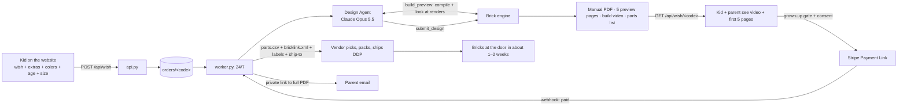

# BrickWish: The Automatic Business

**Goal:** a kid makes a wish, and everything after that happens without a person: design, manual, video, payment, parts order, delivery emails. The founders handle marketing and the rare order the machines can't finish.

**Status (12 Oct 2026):** the core is built and tested end to end in this repo, with the Empire State Building as the test wish. What still needs your accounts (Anthropic API key, Stripe, email, a server, a signed vendor) is listed at the bottom.

## 1. The flow



**Timing per order:** the design agent takes about 1–3 minutes (estimated; it has not run against the live API yet) and the engine about 2 minutes, most of it the video. **Cost per design:** about $0.50–0.80 of Claude usage plus pennies of compute (estimate; measure from the API dashboard).

## 2. Who does what

| Job | Done by | Automatic? | Code |
|---|---|---|---|
| Kid describes the wish, picks options | Website | ✅ | `site/index.html` |
| Strip personal info from the wish | Website + API | ✅ | `scrub()` in both |
| Turn the wish into a 3D brick design, check it, fix it | **Design Agent** (Claude Opus 5.5) | ✅ | `agents/design_agent.py` |
| Brands/characters → generic version; scary → friendly | Design Agent (system prompt rules) | ✅, with a note to the parent | same |
| Bricks, connection check, steps by age, numbered bags | Brick engine | ✅ | `engine/compiler.py` |
| Manual PDF + 5-page preview | Brick engine | ✅ | `engine/manual.py`, `engine/render.py` |
| Build video (9:16, ready for Reels/TikTok/Shorts) | Brick engine | ✅ | `engine/viewer.html`, `engine/browser.mjs` |
| Payment, email, shipping address, builder's name | Stripe Payment Link | ✅ | Stripe dashboard (setup below) |
| Personalize the cover, order parts, email the parent | Worker | ✅ | `agents/worker.py` |
| Pick, pack, label, ship DDP | Vendor | ✅ for us (vendor's people do it) | `engine/vendor.py` makes their files |
| Delete old data (privacy policy) | Worker, hourly | ✅ | `cleanup()` |
| Daily report to founders | Worker, 8:00 Atlanta | ✅ | `daily_report()` |
| Design fails or something breaks | Worker → email to founders | ⚠️ needs a person | `needs_help` state |
| Tracking numbers from vendor → parent | Next to build | ⏳ | an email-reading agent |
| Customer questions, missing pieces | Next to build | ⏳ | a support agent with refund limits |
| Marketing distribution | Your plan | ⏳ | hooks described in §6 |

## 3. "No limits": what's true and what isn't

- **Any idea is accepted.** The agent designs anything: animals, buildings, vehicles, fantasy creatures, "grandma's house".
- **The engine builds with basic bricks today:** plain bricks 1×1 to 2×8, round 1×1 and 2×2 bricks, and 1×1 cones, in a 15-color palette. Models come out as chunky "brick sculptures": very recognizable from the silhouette and colors, less detailed than a retail set. **Next upgrades:** plates and tiles (finer height), slopes (roofs, noses), hinges and wheels.
- **Two limits stay:**
  - **Physics:** every piece must connect, and the piece count must fit the size tier. The engine checks both automatically.
  - **The law:** licensed characters and logos become generic versions ("a superhero spider"), and landmarks are fine to *build*. But don't *advertise* trademarked names: for example, the Empire State Building's name and image are trademarks of its owner (verify before using them in ads). The agent tells the parent when it changed something.

## 4. Running it

```bash
cd brickwish
pip install -r requirements.txt            # the Anthropic SDK
(cd engine && npm install)                 # three.js + fonts for the manual and video
# also needs Node 18+, ffmpeg and Playwright's Chromium on the server

# one design, no website, no API key (uses the example spec):
python3 -m engine.pipeline examples/empire-state-building.json --out out/esb --builder Mateo

# the live system: two processes, kept running by systemd/Docker/your host
python3 -m agents.api       # the website talks to this (put HTTPS in front)
python3 -m agents.worker    # does the work, 24/7
```

**Environment variables:** `ANTHROPIC_API_KEY`, `STRIPE_WEBHOOK_SECRET`, `SITE_ORIGIN`, `PUBLIC_URL`, `SMTP_HOST`/`SMTP_PORT`/`SMTP_USER`/`SMTP_PASSWORD`, `MAIL_FROM`, `FOUNDERS_EMAIL`, `VENDOR_EMAIL`, `DESIGNS_PER_HOUR` (caps AI spend), `DATA_DIR`, `PORT`. Without SMTP settings, emails are saved to `data/outbox/` instead of sent, so you can test safely.

**Hosting:** one small Linux server (2–4 vCPU, 4–8 GB RAM) handles the launch. Software video rendering takes about 2 minutes per order, so one worker does about 15–25 designs per hour. For more, run more workers (add a file lock or move the queue to a database) or a server with a GPU.

### Stripe setup (no code)

1. Create a **Payment Link** per size (Mini $39, Medium $69, Big $99, Mega $179).
2. In each link, turn on **collect shipping address** (US) and add a **custom text field** with key `builder_name`, labeled "Builder's first name for the manual cover (optional)", max 12 characters.
3. Set the after-payment redirect to `https://<your site>/#done`.
4. Add a webhook to `https://<api>/api/stripe` for `checkout.session.completed`, and put its signing secret in `STRIPE_WEBHOOK_SECRET`.
5. Paste the four links into `CONFIG.checkoutLinks` and the API address into `CONFIG.apiBase` in `site/index.html`.

## 5. Tested end to end (in this repo, 12 Oct 2026)

1. `POST /api/wish` with "the Empire State Building, my email is kid@x.com". The email address was stripped before storage.
2. The worker designed it (example spec, since there's no API key here) and produced a 37-page manual, 5 preview pages and an 18-second video.
3. The preview endpoints served the pages and video. The full manual returned **403** without a download code.
4. A fake Stripe webhook with a **bad signature was rejected**. The correctly signed one marked the order paid, with the builder "Mateo" and an Atlanta address.
5. The worker personalized the cover and wrote the vendor email (parts.csv + bricklink.xml attached, labels and DDP instructions included) and the parent email with a private download link. The link returned **200** with the PDF.
6. Design Agent loop tested with a scripted stand-in for Claude:
   - A broken design (floating bricks, too few pieces) got a report plus a picture.
   - The broken submit was **rejected with the reasons**.
   - The fixed design was accepted.

## 6. Marketing hooks (for your plan)

Everything the engine makes is already content:

- **Build videos (9:16).** Ready for Reels, TikTok and Shorts.
- **"Wish of the day".** The agents design *their own* wish every day (a landmark, an animal, a vehicle) and publish the video, with no customer data involved. That's a safe, endless content stream.
- **Customer builds.** Only with the parent's explicit permission (a checkbox after delivery), never the child's name or face by default.
- **Bilingual captions.** A small agent can write EN/ES captions from `model.json` (title, pieces, colors).

Tell us your distribution ideas and we'll wire them into the worker as new stages (e.g. "after preview_ready → post to the content queue").

## 7. What you need to connect

| Item | Why | Where |
|---|---|---|
| Anthropic API key | Design Agent | console.anthropic.com |
| Stripe account + 4 Payment Links + webhook | Payments | §4 |
| Email sending (e.g. Google Workspace, Postmark, SES) | Vendor orders, parent emails | SMTP settings |
| A server or container host | Runs `api.py` + `worker.py` 24/7 | any VPS / Render / Fly / Railway |
| A domain + HTTPS | Website + API | Cloudflare / your registrar |
| A vendor that agrees to the dropship terms | Ships the parts | VENDORS.md §0 |
| Lab testing + CPC before the first kit ships | Required by law | COMPLIANCE.md |
